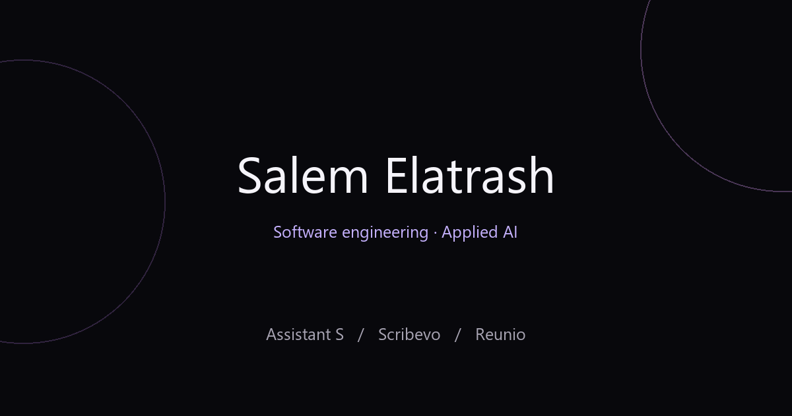

# Salem Elatrash

Computing graduate from **TU Dublin**, studying **MSc Data Analytics at the National College of Ireland**. Based in Dublin. My main interests are Python software engineering, data analytics and applied AI. I also build desktop, browser and mobile interfaces around practical problems.

**Seeking graduate software, AI and data opportunities for 2027.** Expected MSc completion: August 2027.

**Now:** building Teist, an offline AI supplier-assurance agent for banks, selected for **Citi upStart 2026**. I built its local IBM Granite 8B model setup and web interface.

[Portfolio](https://slooma951.github.io/portfolio/) · [Public CV](https://slooma951.github.io/portfolio/downloads/Salem_Elatrash_Public_CV.pdf) · [LinkedIn](https://www.linkedin.com/in/salem-elatrash/)

## Three projects to explore

| Assistant S | Scribevo | Reunio |
| :--- | :--- | :--- |
|  |  |  |
| **Personal desktop assistant.** Talk or type, run several jobs at once, study from my lectures, with local memory and routing across Claude, ChatGPT, Grok and Gemini. | **Published writing extension.** Reviewable spelling support developed from my WordFlow final-year research. | **Lost-property prototype.** Item logging, explainable matches and checked returns for front desks. |
| Electron · JavaScript · Node.js · Three.js | Python · JavaScript · FastAPI · NLP | React Native · Expo · TypeScript |
| [View project](https://github.com/Slooma951/Assistant-S-Showcase) · [Case study](https://slooma951.github.io/portfolio/case-studies/assistant-s.html) | [View project](https://github.com/Slooma951/Scribevo) · [Try Scribevo](https://chromewebstore.google.com/detail/pfpakhloamdgoiokaljdfhpgkbanccci) | [View project](https://github.com/Slooma951/Reunio) · [Try the demo](https://slooma951.github.io/reunio-demo/) |

## What I bring to a team

I connect user needs with application development, data preparation and evaluation. My WordFlow research included a 6,571-pair training dataset and four participant sessions. Later engineering work developed it into Scribevo, with the writer staying in control of each edit.

## Code and evidence you can inspect

| Project | Selected code | Evidence |
| --- | --- | --- |
| Scribevo | [Python edit evaluation + NumPy analysis](https://github.com/Slooma951/Scribevo/tree/main/examples) | [Output, methodology and 11 passing example tests](https://github.com/Slooma951/Scribevo/tree/main/evidence) |
| Assistant S | [JavaScript interface-state function](https://github.com/Slooma951/Assistant-S-Showcase/tree/main/examples) | [Output, methodology and 8 passing example tests](https://github.com/Slooma951/Assistant-S-Showcase/tree/main/evidence) |
| Reunio | [TypeScript shelf search](https://github.com/Slooma951/Reunio/tree/main/examples) | [Output, methodology and 8 passing example tests](https://github.com/Slooma951/Reunio/tree/main/evidence) |

Checked 4 October 2026 on synthetic fixtures. These are tests of selected code, not complete-product audits or user outcomes. Each project explains where its example comes from and how to rerun it.

I use Claude and ChatGPT during planning, implementation and review, then check outputs with tests. The documentation distinguishes my original WordFlow academic research, later AI-assisted engineering and new portfolio examples. The NumPy analysis is a new companion exercise; it is not presented as part of the original model.

**Toolkit:** Python, NumPy, JavaScript, TypeScript, SQL, FastAPI, PyTorch, React, React Native, Electron and Git.

## How to explore my repositories

Start with the three pinned case studies above. They explain the problem, implementation, selected code and evidence limits. Complete product source stays private; public demonstrations and documentation have their own repositories.

| Public repository | Its role |
| --- | --- |
| [portfolio](https://github.com/Slooma951/portfolio) | My Portfolio Website, education, experience and project case studies |
| [Assistant-S-Showcase](https://github.com/Slooma951/Assistant-S-Showcase) | Assistant S's current architecture, development story and selected JavaScript example |
| [Scribevo](https://github.com/Slooma951/Scribevo) | Writing-support case study and selected Python evaluation examples |
| [Reunio](https://github.com/Slooma951/Reunio) | Lost-property case study and selected TypeScript example |
| [reunio-demo](https://github.com/Slooma951/reunio-demo) | Compiled sample-data demo, separate from the development source |
| [Major-Group-Project](https://github.com/Slooma951/Major-Group-Project) | Archived DVS Note team project, with team credit and reproduction limits |

`projectweb` preserves older published Scribevo support/privacy links. My `jev-codex-token-saver` repository is a fork of James Cressler's plugin, not an original product of mine.

**Recent learning:** DataCamp, Introduction to Python, completed 15 November 2026. This is a course completion, rather than a claim of an advanced professional certification.

The pinned projects contain selected code and evidence. Complete product implementations, credentials, personal records and research artefacts stay private. For a walkthrough or graduate opportunity, [connect with me on LinkedIn](https://www.linkedin.com/in/salem-elatrash/).
